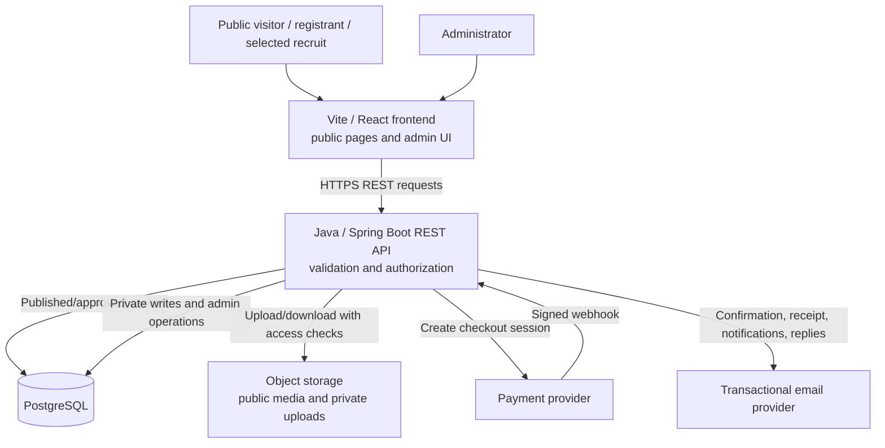

# Soaring Eagles Website — Architecture

**Status:** Target architecture with a partial frontend prototype
**Scope:** New application in `Soaring/`; not a description of the existing root application  
**Requirements source:** [prd.md](./prd.md)  
**Reference notes:** [MASTER_PROJECT_GUIDE.md](./MASTER_PROJECT_GUIDE.md)

> A Vite/React/TypeScript frontend prototype exists under `frontend/`; the
> Spring Boot backend and data-backed public routes have not been implemented.
> Java 21/Spring Boot 3.x/Maven, Supabase PostgreSQL/Storage, Resend, and
> Spring Security admin authentication are selected directions. Hosting and
> payment provider remain open. The frontend's 3D implementation uses Three.js,
> React Three Fiber, and Drei. A live camera feed is not in the current scope.

## 1. Goals and boundaries

The application has three main responsibilities:

1. Publish public club information, projects, events, team profiles, and history.
2. Accept event registrations and contact/member-profile submissions without
   creating public-user accounts.
3. Give authenticated administrators a protected interface to manage content,
   event operations, registrations, submissions, and contact requests.

Private registration, payment, contact, and pending member-profile data must
never be exposed through public routes. Payment credentials are handled by a
payment provider; the application must not store raw card details.

The old website is a source for club-approved content candidates and evidence
about existing visitor flows. Its dependencies, database layout, fallback
behavior, routes, and implementation are not requirements for the new
application.

## 2. Technology stack

### 2.1 Existing website (implemented reference)

The older website lives at the repository root. Its [package manifest](../package.json)
and source confirm this technology stack:

| Area | Technologies used |
|---|---|
| Frontend and build | React 18, TypeScript 5.8, Vite 5, SWC React plugin |
| Styling and components | Tailwind CSS 3, shadcn/ui-style components, Radix UI |
| Routing and data fetching | React Router 6 with `HashRouter`; TanStack React Query |
| Forms and validation | React Hook Form, Zod, `@hookform/resolvers` |
| Backend data and files | Supabase JavaScript client for PostgreSQL, Auth, and Storage |
| Privileged admin API | Node.js, Express 4, CORS |
| Contact email | EmailJS browser SDK |
| UI and utility libraries | Framer Motion, Lucide React, Sonner, date-fns |
| Additional packages in the manifest | XLSX, Recharts, Google APIs, Embla Carousel, Vaul |
| Quality and styling tools | ESLint 9, TypeScript, PostCSS, Autoprefixer |

The root project has Vite scripts for development/build/preview and scripts
for starting the Express admin server. These are the old site's actual
dependencies and configuration, not a declaration that every dependency is
used by the new application.

### 2.2 Planned website (selected direction; partially implemented)

The selected direction is a Vite/React frontend with a separate Java 21,
Spring Boot 3.x modular-monolith backend built with Maven, and PostgreSQL
hosted by Supabase. The implementation sequence is frontend-first. Admin authentication uses Spring Security with
username/password and managed credentials; password-only is the selected
launch policy, with email as the unique admin identifier and verified-email
password reset. Prevent deletion of the last active admin and confirm
self-removal. Supabase Storage and Resend are selected for files and
transactional email. Hosting/domain and payment provider remain open.

| Area | Proposed technology | Rationale / boundary |
|---|---|---|
| Frontend | Vite, React, TypeScript | Public pages and admin UI in a single-page app; frontend communicates with the backend over HTTP and does not own privileged operations. |
| UI and styles | Current prototype: React components and project CSS (`App.css`, `index.css`); no Tailwind dependency | Continue the existing charcoal/off-white/copper theme and Space Grotesk/IBM Plex Mono typography. A future component system remains to be selected if needed. |
| Forms and validation | Current contact form uses native React form controls and client-side validation; no backend validation exists yet | Keep accessible submission/error states and add server-side validation with the future API. A shared form library is not selected. |
| Backend API | Java 21, Spring Boot 3.x, Spring Web, Maven | Modular monolith owning business rules, server-side validation, authorization, and integrations. |
| Persistence | PostgreSQL hosted by Supabase; Spring Data JPA; Flyway migrations | Relational records fit events, registrations, teams, profiles, content, and contact histories. |
| Authentication | Spring Security username/password with managed credentials; email identifier and verified-email reset | Admin-only access; password-only at launch. Prevent deletion of the last active admin and confirm self-removal. |
| File storage | Supabase Storage | Keep pending profile images and contact attachments private; publish approved public media deliberately. |
| 3D hero | Three.js with React Three Fiber and Drei; GSAP is present in the existing frontend | Render the approved GLB interactively and honor reduced-motion preferences. |
| Live drone feed | Not included in the current scope | Do not add a feed toggle or imply a live stream is available. Revisit only as a separately approved feature. |
| Payments | Provider-neutral integration; INR payment provider undecided | Verify payment status on the backend using authenticated provider callbacks/webhooks. |
| Email | Resend, through a server-side adapter | Contact notifications/replies and event confirmations; no automatic member-profile emails. |
| Testing and quality | TypeScript checks and ESLint for frontend; JUnit/Spring tests for backend; browser tests for critical flows | GitHub pull requests, automated CI, and preview deployments are selected. |
| Hosting | Separate frontend and Spring Boot hosting; prefer existing domain if available | Hosting provider and domain availability remain undecided. |

The Spring Boot backend is the only application boundary for privileged
operations. Never expose database credentials, payment secrets, email secrets,
or other privileged keys through browser-delivered configuration.

## 3. High-level architecture



### Responsibilities

- **Frontend application:** Render accessible pages and forms. The current
  Home prototype is hero → upcoming-event empty state → contact details/form →
  footer, with native document scrolling and a decorative event canvas. It
  calls the Spring Boot API and does not connect directly to privileged
  database, payment, or email credentials. The contact API and event-data
  connection do not exist yet; a live aircraft feed is not part of the current
  homepage.
- **Admin application:** Present management workflows only after sign-in. UI
  visibility is not an authorization control.
- **Spring Boot API:** Validate requests, establish the caller's identity and
  role, enforce business rules, and own privileged database, storage, payment,
  and email operations.
- **Database:** Be the source of truth for publication state, registration
  state, payment references, moderation, and contact history.
- **Storage:** Separate public, approved media from private attachments and
  pending profile uploads. Use short-lived access links for private files.
- **External providers:** Payments and email are replaceable integrations;
  provider-specific payloads should not leak into page components or core
  domain types.

Use row-level security or equivalent database authorization as defense in
depth. Public queries should return only explicitly published/approved records.
Administrative writes and private reads must require authorization verified
by the Spring Boot backend.

## 4. Application flows

### 4.1 Public browsing

1. In the current prototype, a visitor scrolls from the existing hero to an
   upcoming-event empty state with a decorative canvas, then to the contact
   details and form, and finally the footer. The form submission is not
   connected to a backend; it reports the failure and provides an email
   fallback.
2. The intended full site has separate About, Team, Projects, Events, Journey,
   and Contact routes; these routes are not implemented in the prototype.
   Existing header/hero links still target removed homepage anchors and need
   alignment with the eventual navigation/routes.
3. Public page loaders will request only published content. Team queries include
   approved profiles only and group them by study year.
4. If there are no upcoming events or approved profiles, pages render designed
   empty states rather than failing.

### 4.2 Event registration and payment

1. The visitor opens a published, open event and sees its fee, eligibility,
   deadline, event type, and remaining capacity.
2. The visitor submits either the individual form or the team form. The backend
   validates the selected event, required fields, team-size limits, deadline,
   and capacity.
3. The backend creates a pending registration/payment attempt and requests a
   checkout session from the configured payment provider. The registration is
   not yet confirmed.
4. The visitor completes or abandons checkout. The browser return page is
   informative only; it is not proof of payment.
5. The backend verifies the provider's signed callback/webhook, makes the
   payment update idempotently, rechecks event capacity, and confirms the
   registration only after verified success.
6. On verified success, the server sends the event details and receipt to the
   individual registrant or team captain. On failure/abandonment, the
   registration remains unconfirmed and the visitor can retry.
7. Capacity enforcement must be atomic so concurrent checkouts cannot exceed
   the configured limit. A temporary hold during checkout is selected; hold
   duration and expiry mechanics remain to be decided with the payment provider.

### 4.3 Admin event and content management

1. An administrator signs in with an email address and password. Password
   recovery uses a verified-email reset flow.
2. Spring Security and backend authorization verify the session and admin permission for each operation;
   the browser does not receive privileged credentials.
3. New events are saved as drafts. An explicit publish action makes them
   visible; the event's end date determines when it moves to the past-events
   presentation.
4. Admins create and update projects, Journey entries, team profiles, and
   contact details. Successful public content changes become visible
   immediately.
5. Admins review paid registrations, edit permitted details, and export an
   Excel-compatible file. Event registrant/team/payment data remains private.

### 4.4 Selected-recruit profile moderation

1. A selected recruit opens one shared secret submission link, manually
   rotated by the club; no account is created.
2. The backend validates profile fields and image format/size, then stores the
   submission as pending with its image in private storage.
3. The profile remains invisible publicly until an admin approves it.
4. Approval publishes only the allowed public fields and makes the profile
   visible in the correct study-year group.
5. Rejection deletes the submission as required by the PRD. This workflow
   sends no automatic email.
6. The link's expiry, revocation, or other access-limiting mechanism is not
   specified yet and must be decided before release.

### 4.5 Contact requests and replies

1. A visitor submits their name, email, subject, message, and optional
   attachment.
2. The backend validates the request and file, stores the request and private
   attachment, and queues/sends a notification to the club.
3. If notification delivery fails, the request remains stored and the system
   reports delivery failure to the admin rather than losing the inquiry.
4. An admin replies from the portal. The reply is retained in request history;
   delivery failure is visible and retryable.

### 4.6 Event archival

When an event's scheduled end time passes, it is no longer treated as upcoming
and is shown in the past-events area. The data remains editable by admins for
archive story, photos, and results. The transition should be computed from
persisted event dates or performed by a reliable scheduled process; it should
not depend on a visitor having loaded the page at the right moment.

## 5. Main application areas

| Area | Primary responsibilities |
|---|---|
| Public pages | Home, About, Team, Projects, Events, Journey, Contact |
| Event registration | Event detail, eligibility, individual/team forms, checkout and outcome states |
| Member profile | Shared selected-recruit submission link, private pending profile, approval/rejection |
| Admin dashboard | Event lifecycle, registrations/export, projects/Journey/team/contact content, contact inbox, admin accounts |
| Identity and authorization | Email/password admin login, verified-email reset, permission checks, and admin account lifecycle |
| Content/media | Published records, public images/video, private submissions/attachments |
| Integrations | Payment gateway, transactional email, managed auth, database, object storage |

## 6. Proposed data model

The following entities are derived from the PRD and should be refined before
database migrations are written:

- **Admin account:** Unique email identity, active/disabled state, timestamps, and
  audit information. All admins share management permissions per the PRD.
- **Event:** Event details, fee/currency, eligibility, registration type,
  deadline, capacity, team-size bounds, publication state, start/end times, and
  archive content.
- **Registration:** Event reference, individual/team type, participant or
  captain details, private status, and timestamps.
- **Team member:** Registration reference and each required participant's
  name, email, year, department, and institution.
- **Payment attempt:** Registration reference, provider reference, amount,
  status, idempotency key, and verified timestamps. Do not store card
  credentials.
- **Member profile submission:** Public profile fields, private review state,
  image reference, and timestamps. Only approved fields are exposed publicly.
- **Project:** Name, summary, full description, year, status, technologies,
  and media references.
- **Journey entry:** Date, title/milestone, story, and media references.
- **Contact request:** Sender, subject/message, private attachment reference,
  status, and timestamps.
- **Contact reply:** Contact request reference, author/admin, message, delivery
  status, and timestamps.
- **Audit event:** Admin identity, action, affected entity, and time for
  sensitive operations such as account changes, approvals, event publishing,
  and registration edits.

Likely relationships: one event has many registrations; a team registration
has multiple team members; a registration can have multiple payment attempts;
a contact request has zero or more replies. Media is referenced by projects,
Journey entries, events, profiles, or contact requests according to visibility
and ownership.

## 7. Proposed folder and file structure

This is the target structure; the complete layout does not exist yet. The
current frontend prototype is a Vite app under `frontend/`, with its Home
composition in `src/App.tsx`, styling in `src/App.css`/`src/index.css`, and
shared visual components in `src/components/`. The `backend/` application and
planned feature routes do not exist yet. Keep the existing `assets/` library
and copy approved assets into frontend public or managed-media locations as
implementation proceeds.

```text
Soaring/
  assets/
    brand/
    events/
    projects/
    team/
    site/
  frontend/
    public/
      favicon.ico
      robots.txt
    src/
      app/
        App.tsx
        routes/
        providers/
      pages/
        Home.tsx
        About.tsx
        Team.tsx
        Projects.tsx
        Events.tsx
        EventDetails.tsx
        Journey.tsx
        Contact.tsx
        MemberProfile.tsx
        admin/
      styles/
        globals.css
      components/
        layout/
        navigation/
        forms/
        content/
        ui/
      features/
        events/
        registrations/
        profiles/
        projects/
        journey/
        contacts/
        admin/
      lib/
        api/
        validation/
        formatting/
      types/
    package.json
  backend/
    src/
      main/
        java/<package>/
          SoaringEaglesApplication.java
          config/
          security/
          common/
          events/
          registrations/
          profiles/
          projects/
          journey/
          contacts/
          admin/
          integrations/
        resources/
          application.yml
          db/migration/
      test/
        java/<package>/
    pom.xml or build.gradle
    .env.example
  .env.example
  .gitignore
  README.md
```

Spring controllers expose REST endpoints; feature services own business rules;
repositories use Spring Data JPA; Flyway migrations define schema changes.
Spring Security guards private endpoints. Payment webhooks, uploads, and email
integrations are implemented in backend modules. Frontend components handle
interaction and presentation, not authorization or payment verification. Keep
feature-specific rules close to their feature and share only genuinely common
UI, validation, and server utilities.

## 8. Security and reliability requirements

- Enforce admin permissions on every server-side read/write of private data.
- Restrict public database access to published content and approved profile
  fields; do not serialize private columns into public responses.
- Store contact attachments and pending profile images privately. Validate
  file type and size on the server and use access-controlled downloads.
- Verify payment signatures server-side; treat browser redirects as
  untrusted; make webhook handling idempotent.
- Use a transaction or equivalent atomic capacity check for registration
  confirmation and event limits.
- Keep provider secrets in the deployment secret store, never in source control
  or client bundles.
- Record admin audit events for elevated and destructive actions. Since every
  admin may add/remove admins, require strong authentication and prevent
  accidental removal of the last usable administrator; exact policy requires
  owner approval.
- Preserve contact requests when email delivery fails and show delivery status
  to admins.
- Keep registration, payment, profile, and contact states distinct; never show
  success before persistence or payment verification succeeds.

## 9. Use of the older website as a reference

The existing application at the repository root is an implemented reference.
Its source confirms reusable content and useful flows, including a public team
roster, projects and event history, recruitment submissions, separate member
profile submissions with moderation, an admin portal, Supabase usage, and an
Express service boundary for privileged operations.

The rebuild should preserve the **distinction** between event/recruitment
submissions and member-profile publishing, and between public content and
admin-only data. It should not copy the old application's `localStorage`
fallbacks, duplicate sources of truth, dependency list, or route behavior as
design requirements. The old route setup sends `/events` to past events and
does not provide a complete event-payment flow; the new event journeys should
follow the PRD, not that route wiring. The old implementation uses Express for
privileged admin operations; the planned backend replaces that boundary with
Spring Boot and PostgreSQL.

Reference source locations:

- [Old app routes](../src/App.tsx)
- [Old public team page](../src/pages/Team.tsx)
- [Old profile submission](../src/pages/MemberProfile.tsx)
- [Old registration forms](../src/components/SimpleRegistrationForms.tsx)
- [Old admin dashboard](../src/components/ComprehensiveAdminPanel.tsx)
- [Old privileged API](../server/admin-server.js)
- [Reviewed assets inventory](./assets/README.md)

Do not migrate personal registration data, contact details, or payment data.
Verify all copied names, dates, claims, links, and images with the club before
publication.

## 10. Decisions required before implementation

The architecture can be refined after the owner confirms the PRD decisions:

1. Frontend/backend hosting and existing domain availability.
2. INR payment provider and provider-specific payment/receipt requirements.
3. Admin password reset, lockout, and credential-management implementation;
   password-only is the selected launch policy.
4. How selected recruits receive and manually rotate the shared secret link.
5. Data retention periods for registrations, contacts, payments, and rejected
   profiles.
6. Final content approval, visual review, and accessibility acceptance.

Vite/React, Java 21/Spring Boot 3.x/Maven, modular-monolith structure,
PostgreSQL on Supabase, Supabase Storage, and Resend are selected directions.
The PRD remains the source of product requirements.
